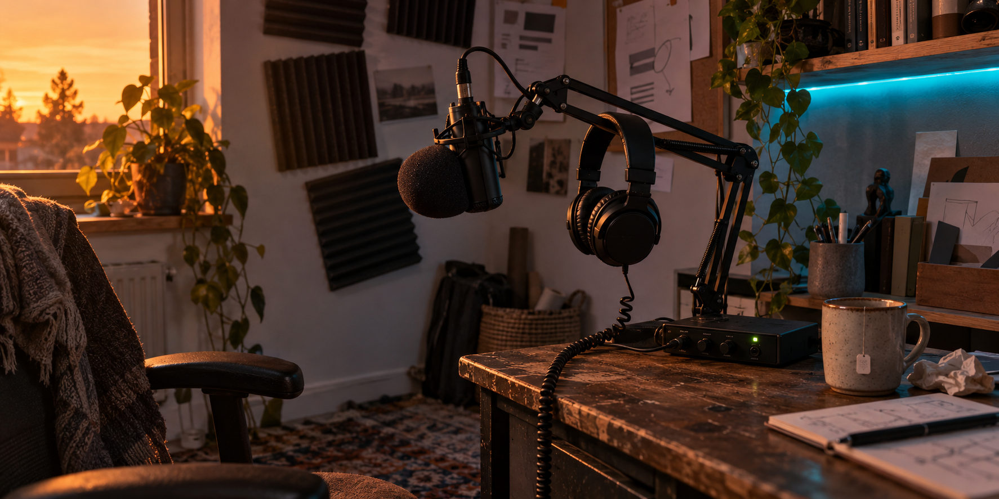

I'm acting CEO of Apliteni and build Lepsto and many other cool things.

## I'm working on

- [Lepsto](https://lepsto.com/): hosting, app components, analytics, helpdesk, and agent tools for solo founders.
- [Apliteni](https://apliteni.com/): marketing software for businesses.

## Agent Skills

I made these from coding-agent work. Install and use them, and send issues or pull requests.

- [ai-slop-detector](https://github.com/asabirov/ai-slop-detector-skill): reviews prose, interfaces and code comments for empty claims and clutter.
- [github-attachments](https://github.com/asabirov/github-attachments-skill): uploads a local image to GitHub and returns a link, without committing the file.
- [better-skill-creator](https://github.com/asabirov/better-skill-creator-skill): creates and maintains your own agent skills, checks them through real use.
- [diagrams](https://github.com/asabirov/diagrams-skill): picks a diagram type, draws it in D2 in a hand-drawn style and checks the picture.
- [everything-to-pdf](https://github.com/asabirov/anything-to-pdf-skill): converts Markdown, text, code, images, local HTML or a web page to PDF.
- [security-risk](https://github.com/asabirov/security-risk-skill): reviews a written design for security risk, and assesses only a target that you authorized.
- [code-smells](https://github.com/asabirov/code-smells-skill): fails the check when a Go or TypeScript function, file or package grows past its recorded limit. A check costs about 30 to 80 tokens.
- [sketch](https://github.com/asabirov/sketch-skill): draws disposable one-ink UI sketches from 43 templates in 22 categories.

Reach me on [LinkedIn](https://www.linkedin.com/in/asabirov/) or [X](https://x.com/artsabirov) if you want to talk.
